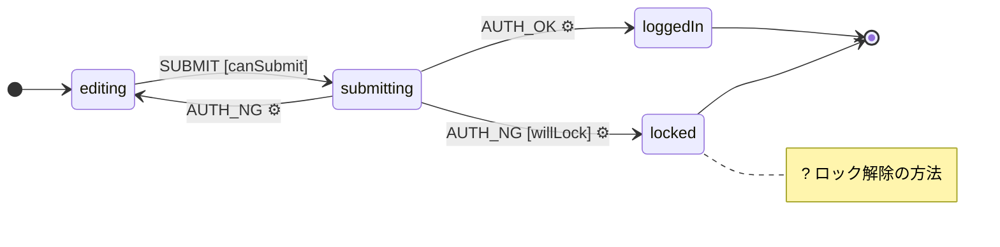
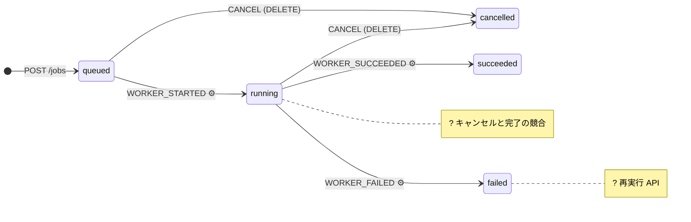

# Phase 0 spike: 正本フォーマット比較

> 使い捨ての検証。結論は ADR に移し、このディレクトリは Phase 1 着手時に削除してよい。

同じ 2 題材を 2 つの書式で書いて比較した。

| | YAML + JSON Schema | TS DSL |
|---|---|---|
| A. ログイン（UI） | [yaml/login.spec.yaml](yaml/login.spec.yaml) | [ts/login.spec.ts](ts/login.spec.ts) |
| B. ジョブ API | [yaml/job-api.spec.yaml](yaml/job-api.spec.yaml) | [ts/job-api.spec.ts](ts/job-api.spec.ts) |

## 生成されるビューのイメージ

正本から機械的に生成する想定の Mermaid（ここでは手書き）。`?` は未決事項が付いている状態。

⚙ = `trigger: system`（クライアントの操作ではなく内部で発生するイベント）

## 比較

| 観点 | YAML + JSON Schema | TS DSL | 重み |
|---|---|---|---|
| **言語に依存しない** | ◎ Python、Go のプロジェクトやデータ基盤でもそのまま置ける | △ Node が要る。TS 以外のプロジェクトに入れるのは重い | **高**（スコープを UI 以外にも広げたため） |
| **決定的な差分** | ◎ データなので、書き方の揺れが小さい | △ 共通化（`getJob`、`cancel`）や関数で書けるので、AI がリファクタすると構造は同じでも差分が大きくなる | **高**（差分レビューが核心） |
| **静的に解析できる** | ◎ そのまま読める | × guard と effect が関数なので、lint や図の生成には実行か AST 解析が要る | 高 |
| **参照の型安全性**（`to:` の状態 ID など） | △ JSON Schema では検出できず、独自の lint が要る | ◎ 型で検出できる | 中（どのみち lint は作る） |
| **AI の書きやすさ** | ○ | ○ | 中（どちらも問題なかった） |
| **重複の削減** | △ 同じ HTTP 例の繰り返しが冗長（B の `GET /jobs/{id}`） | ◎ 関数で共通化できる | 低（正本は人が読まない前提） |
| **書き間違いへの強さ** | △ フロー記法の中の `{id}` が構文エラーになった（実際にこの spike で踏んだ）。Schema と lint で早めに検出する必要がある | ○ 構文エラーはエディタがすぐ出す | 中 |
| **guard と effect の表現** | △ 文字列の式になる。式言語が要る | ◎ ふつうのコード | 中 |

## 分かったこと

1. **モデルの骨格は、UI でも API でも同じでよかった。** 状態、遷移、サーフェス、シナリオ、未決事項の 5 要素で両方を書けた。違いはサーフェスの中身（`ui:` か `http:`）だけ。
2. **`trigger: system` は必須の概念だった。** API では遷移の半分以上が内部イベントで、テストを生成するとき「クライアントが起こせない遷移」を別扱いする必要がある（モックや fixture で状態を作るなど）。
3. **サーフェスの要素 ID が、テストの足場になる。** `do: click submit` や `enabled: canSubmit` が要素 ID を参照するので、サーフェスがそのまま操作とアサーションの対象になる。
4. **guard を「説明 + 式 + 例」にすると読みやすい。** `willLock` の examples は、そのまま判断表としてビューに出せる。
5. **TS DSL の「共通化できる」ことは、このツールでは欠点になる。** 正本を人が読む前提なら DRY のほうが嬉しい。しかし live-spec では人は図と差分を読む。正本に求めるのは、平坦で決定的なことである。

6. **宣言していない変数を参照するミスが実際に起きた。** 最初の YAML 案で、guard が `email` / `password` を参照しているのに `context` で宣言していなかった。TS なら型で検出できるが、YAML では lint が必須になる（MVP の lint 項目に「式が未宣言の context 変数を参照していないか」を加える）。

## 結論

**TypeScript DSL を採用した**（[ADR-0004](../../docs/decisions/0004-spec-format-typescript-dsl.md)）。下の推奨（YAML）は検討時点のもので、型安全性と表現力を優先して覆った。YAML の利点だった差分の決定性は、正規化モデルで差分を取ることで補う。

## 推奨（検討時点）

**YAML + JSON Schema を正本にする。** 重みの高い 3 観点（言語に依存しない、決定的な差分、静的に解析できる）で TS DSL を上回る。参照の型安全性は、どのみち作る lint で補う。

### 次に決めること（ADR に残すこと）

- **guard と effect の式言語**: 候補は [CEL](https://cel.dev/)（言語非依存で仕様が公開されている）、JSONLogic、独自の最小サブセット
- **ファイルの単位**: 1 spec 1 ファイルか、大きくなったら分割を許すか
- **サーフェスの種類**: `ui`、`http`、`cli`、`data` を最初から定義するか、`ui` と `http` から始めるか

## 検証していないこと

- CLI とデータ基盤（題材 C、D）はまだ書いていない。`cli` サーフェスは `http` と同じく「入力と出力の例」で書けそうだが、未確認
- AI に、フォーマットの説明だけを渡して書かせる検証（MVP の完了条件）は、JSON Schema を作ってから行う
